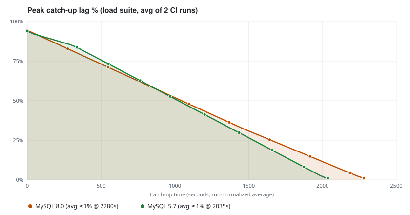
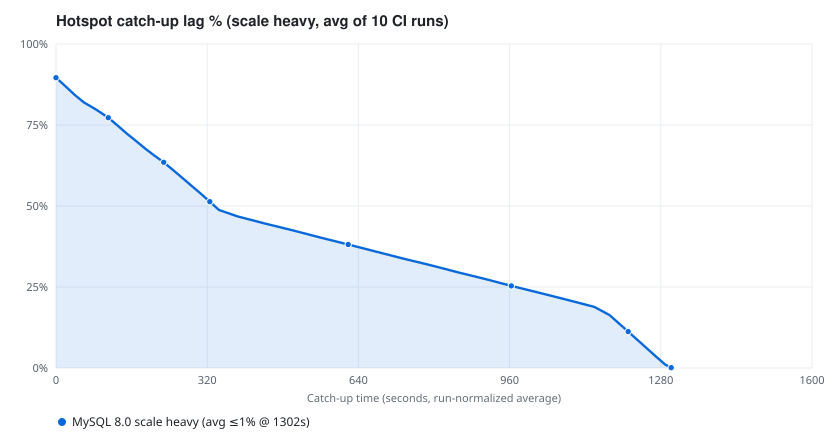

# go-cdc

[Chinese](README.zh.md)

## Introduction

go-cdc is a YAML-driven Change Data Capture (CDC) tool. You describe one sync job in a single YAML file: capture full and incremental changes from MySQL, apply optional transform and route, then write to **stdout**, **MySQL**, **Kafka**, **Doris**, **Elasticsearch 7/8/9**, or **PostgreSQL** (Kafka / Doris at-least-once; Elasticsearch uses the Bulk API with idempotent writes; PostgreSQL applies current-state DML). One process, one config, one binary: `go-cdc`.

Features in this release:

- MySQL source (snapshot + binlog)
- Stdout sink (newline-delimited JSON), MySQL sink, Kafka sink (at-least-once), Doris sink (UNIQUE KEY + Stream Load, at-least-once), Elasticsearch 7/8/9 sink (`sink.version`, default 8), and PostgreSQL sink (current-state DML, with opt-in table creation and schema evolution)
- Projection, filter, table route, schema-change policy, file checkpoints
- **Note:** stdout JSON now uses the shared Debezium-inspired envelope (`source.db` / `source.table`); older top-level `database` / `table` fields are gone

## Build Environment


| Item             | Requirement                                  |
| ---------------- | -------------------------------------------- |
| OS               | Linux / macOS / Windows                      |
| Go               | **1.25+** (see `go.mod`)                     |
| Source / sink DB | MySQL **5.7** or **8.0**                     |
| Source binlog    | `binlog_format=ROW`, `binlog_row_image=FULL` |


### Install with `install.sh` / `install.ps1`

Builds from source, then installs the `go-cdc` binary.


| Platform      | Default install path | Script                       |
| ------------- | -------------------- | ---------------------------- |
| Linux / macOS | `$HOME/bin`          | `[install.sh](install.sh)`   |
| Windows       | `%USERPROFILE%\bin`  | `[install.ps1](install.ps1)` |


**Linux / macOS**

```bash
# User install → $HOME/bin
curl -sSfL https://raw.githubusercontent.com/PyRSA/go-cdc/main/install.sh | bash -s

# Install into $(go env GOPATH)/bin
curl -sSfL https://raw.githubusercontent.com/PyRSA/go-cdc/main/install.sh | bash -s -- -b "$(go env GOPATH)/bin"

# Install into ./bin (current directory)
curl -sSfL https://raw.githubusercontent.com/PyRSA/go-cdc/main/install.sh | bash -s -- -b ./bin

# Global → /usr/local/bin (may need sudo)
curl -sSfL https://raw.githubusercontent.com/PyRSA/go-cdc/main/install.sh | bash -s -- --global
```

From a local clone:

```bash
git clone https://github.com/PyRSA/go-cdc.git
cd go-cdc

./install.sh                  # $HOME/bin
./install.sh --user           # same as default
./install.sh --global         # /usr/local/bin
./install.sh -b /opt/go-cdc/bin
make build                    # build only → ./bin/go-cdc
```

**Windows (PowerShell)**

```powershell
# One-liner (build + install to %USERPROFILE%\bin, update user PATH)
irm https://raw.githubusercontent.com/PyRSA/go-cdc/main/install.ps1 | iex

# Or from a local clone
git clone https://github.com/PyRSA/go-cdc.git
cd go-cdc

.\install.ps1
.\install.ps1 -BinDir "$env:USERPROFILE\bin"
.\install.ps1 -BinDir "$(go env GOPATH)\bin"
```

Optional checks:

```bash
make fmt-check   # gofmt
make lint        # golangci-lint (.golangci.yml)
make test        # go test -race
```


## Quick Start

See the guides under `[docs/](docs/)`:

- [QuickStart](docs/QuickStart.md)
- [Pipeline](docs/pipeline.md)
- Source connectors
  - [MySQL Source](docs/connectors/mysql-source.md)
- Sink connectors
  - [MySQL Sink](docs/connectors/mysql-sink.md)
  - [Stdout Sink](docs/connectors/stdout-sink.md)
  - [Kafka Sink](docs/connectors/kafka-sink.md)
  - [Doris Sink](docs/connectors/doris-sink.md)
  - [Elasticsearch Sink](docs/connectors/elasticsearch-sink.md)
  - [PostgreSQL Sink](docs/connectors/postgresql-sink.md)

**Minimal run (MySQL → stdout):**

1. Edit `[configs/demo-stdout.yaml](configs/demo-stdout.yaml)` (host, user, password, `tables`).
2. Start the job:

```bash
./bin/go-cdc configs/demo-stdout.yaml
```

3. For MySQL → MySQL, use `[configs/demo-mysql.yaml](configs/demo-mysql.yaml)`.
4. For MySQL → Doris, use `[configs/demo-doris.yaml](configs/demo-doris.yaml)`.
5. For MySQL → Elasticsearch, use `[configs/demo-elasticsearch.yaml](configs/demo-elasticsearch.yaml)`.


## Performance

go-cdc includes automated MySQL integration and scale tests in GitHub Actions
to validate snapshot replication, incremental CDC processing, multi-database
replication, hotspot workloads, and catch-up behavior under sustained write
pressure.

Results below are **averages of 10 CI runs** per scenario (load per MySQL
version; scale heavy). **Source write** and **CDC apply** are different metrics.
Charts use run-normalized average lag curves and collapse flat plateau segments.
Load peak knobs are now **4×60s**; catch-up timings/chart below are still from
prior **4×90s** samples until remeasured.

### Load test


| Metric              | MySQL 5.7.42                     | MySQL 8.0.36                     |
| ------------------- | -------------------------------- | -------------------------------- |
| **Test type**       | **Load** (func + types + load)   | **Load** (func + types + load)   |
| Snapshot            | ~500K rows / ~130s (avg)         | ~500K rows / ~152s (avg)         |
| Peak source write   | 60s (est. final src ≈1.5M/table) | 60s (est. final src ≈1.2M/table) |
| Stressed tables     | 2 (`tpl01_t1` + typed)           | 2 (`tpl01_t1` + typed)           |
| Aggregate CDC apply | ~2.8K rows/s (2 tables, avg)     | ~1.9K rows/s (2 tables, avg)     |
| CDC catch-up        | ≤1% lag in ~2035s (~34 min)*     | ≤1% lag in ~2280s (~38 min)*     |
| Result              | **PASS**                         | **PASS**                         |

\*Prior 4×90s CI average; expect roughly ~⅔ wall time under 4×60s.

Lag-over-time chart (same load suite on 5.7 vs 8.0, averaged; prior 4×90s):  


### Scale test (heavy)

MySQL **8.0.36** only (no 5.7 scale matrix in CI): 10 source databases, 50
tables, concurrent hotspot workloads — separate chart from load.


| Metric              | Result (avg of 10 heavy runs)         |
| ------------------- | ------------------------------------- |
| **Test type**       | **Scale** (heavy)                     |
| Databases / tables  | 10 DBs / 50 tables                    |
| Snapshot            | 300K rows / ~133s                     |
| Hotspot burst       | 500K rows / ~17s                      |
| Peak source write   | ~1.17M rows / 45s (~26K rows/s)       |
| Hotspot tables      | 10                                    |
| CDC catch-up        | ≤1% lag in ~1302s (577s / 2027s)      |
| Final verification  | COUNT + SUM(id) + CRC passed          |
| Result              | **PASS**                              |


Hotspot catch-up lag (mean of 10 tables, averaged runs):  



These results come from GitHub Actions shared runners and should not be
treated as vendor-grade benchmarks. Results depend on the CI environment,
MySQL configuration, workload, and test parameters.

For detailed workload definitions, test methodology, and CI results, see
[Performance Stress Testing: MySQL → MySQL (E2E)](docs/performance/mysql-to-mysql-e2e.md).

## Contributing

1. Fork the repository and create a feature branch.
2. Keep changes focused; follow existing package layout (`cmd/`, `composer/`, `connector/`, `runtime/`).
3. Before opening a PR:
  - `make fmt-check`
  - `make lint`
  - `make test`
  - For behavior that touches sync paths, run integration tests when possible:
    `make it-mysql && make it-down SINK=mysql`
4. Describe the problem and how you verified the fix in the PR description.

Integration harness notes: [tests/integration/README.md](tests/integration/README.md).

## License

This project is licensed under the [MIT License](LICENSE).
