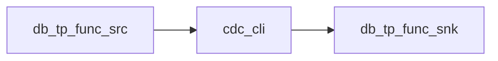

# go-cdc integration test report (expected vs actual)

<a id="overview"></a>

## 0. Overview

- Run time: 2026-10-11 21:59:57
- Source: `127.0.0.1:13306` / `u_a7k9m2x4` / `db_tp_func_src`
- Sink: `127.0.0.1:13306` / `u_b3j6c8y1` / `db_tp_func_snk`
- Entry point: `${PROJECT_ROOT}/test/integration/workdir/go-cdc <pipeline.yaml>`
- **Summary: pass 20 / fail 0 / total 20** → **all passed**

| TP | Name | Result |
| --- | --- | --- |
| [TP-01](#tp-01) | Initial snapshot + projection/filter (city=hz) | ✅ PASS |
| [TP-02](#tp-02) | Business key docid: old key gone, new key kept | ✅ PASS |
| [TP-03](#tp-03) | Same-key update overwrites (no extra row) | ✅ PASS |
| [TP-04](#tp-04) | Filter miss retract (sink delete) | ✅ PASS |
| [TP-05](#tp-05) | Filter: match enters / miss excluded | ✅ PASS |
| [TP-06](#tp-06) | DELETE retracts by before-image key | ✅ PASS |
| [TP-07](#tp-07) | Create-table failure does not exclude table; job continues | ✅ PASS |
| [TP-08](#tp-08) | Write after create failure: missing table fails job | ✅ PASS |
| [TP-09](#tp-09) | Extra projected columns not applied; in-projection type change applied | ✅ PASS |
| [TP-10](#tp-10) | After stop, add existing table: backfill that table only | ✅ PASS |
| [TP-11](#tp-11) | Runtime CREATE TABLE: follows incremental and updates captured | ✅ PASS |
| [TP-12](#tp-12) | stdout CRUD: u with before/after + ddl | ✅ PASS |
| [TP-13](#tp-13) | Resume state: splits and offset in one file | ✅ PASS |
| [TP-14](#tp-14) | Abnormal stop (SIGKILL) then resume from checkpoint | ✅ PASS |
| [TP-15](#tp-15) | Combo#1 A=false C=false: ignore diff + drop CREATE | ✅ PASS |
| [TP-16](#tp-16) | Combo#2 A=false C=true: ignore diff + follow CREATE | ✅ PASS |
| [TP-17](#tp-17) | Combo#3 A=true B=true C=false: snapshot diff + drop CREATE | ✅ PASS |
| [TP-18](#tp-18) | Combo#4 A=true B=true C=true: snapshot diff + follow CREATE | ✅ PASS |
| [TP-19](#tp-19) | Combo#5 A=true B=false C=false: binlog-only diff + drop CREATE | ✅ PASS |
| [TP-20](#tp-20) | Combo#6 A=true B=false C=true: binlog-only diff + follow CREATE | ✅ PASS |

## 1. Data flow



## 2. Test points

<a id="tp-01"></a>

## TP-01 Initial snapshot + projection/filter (city=hz)

- [↑ Overview](#overview)
- **Result: ✅ PASS**
- **Action:** First start: project id,name,city; filter city='hz'
- **Expected:** Sink has id=1,3 only; no amount; no id=2

### Expected vs actual

| Key/# | exp.id | exp.name | exp.city | act.id | act.name | act.city | Verdict |
| --- | --- | --- | --- | --- | --- | --- | --- |
| 1 | 1 | alice | hz | 1 | alice | hz | ✅ |
| 3 | 3 | ann | hz | 3 | ann | hz | ✅ |
| Summary |  |  |  |  |  |  | **✅ PASS** |

### Extra evidence

- Sink columns: `['city', 'id', 'name']` → ✅
- Filtered-out id=2: ✅ absent


<a id="tp-02"></a>

## TP-02 Business key docid: old key gone, new key kept

- [↑ Overview](#overview)
- **Result: ✅ PASS**
- **Action:** UPDATE tp02_keys SET docid='B', title='title-b'
- **Expected:** Sink only (B, title-b)

### Expected vs actual

| Key/# | exp.docid | exp.title | act.docid | act.title | Verdict |
| --- | --- | --- | --- | --- | --- |
| B | B | title-b | B | title-b | ✅ |
| Summary |  |  |  |  | **✅ PASS** |

### Extra evidence

- No id column: ✅


<a id="tp-03"></a>

## TP-03 Same-key update overwrites (no extra row)

- [↑ Overview](#overview)
- **Result: ✅ PASS**
- **Action:** UPDATE tp01_rows SET name='alice2' WHERE id=1
- **Expected:** Still two rows; id=1 name=alice2

### Expected vs actual

| Key/# | exp.id | exp.name | exp.city | act.id | act.name | act.city | Verdict |
| --- | --- | --- | --- | --- | --- | --- | --- |
| 1 | 1 | alice2 | hz | 1 | alice2 | hz | ✅ |
| 3 | 3 | ann | hz | 3 | ann | hz | ✅ |
| Summary |  |  |  |  |  |  | **✅ PASS** |

<a id="tp-04"></a>

## TP-04 Filter miss retract (sink delete)

- [↑ Overview](#overview)
- **Result: ✅ PASS**
- **Action:** UPDATE tp01_rows SET city='bj' WHERE id=3 (source no longer matches city='hz')
- **Expected:** Sink deletes id=3; only rows still matching filter remain

### Expected vs actual

| Key/# | exp.id | exp.name | exp.city | act.id | act.name | act.city | Verdict |
| --- | --- | --- | --- | --- | --- | --- | --- |
| 1 | 1 | alice2 | hz | 1 | alice2 | hz | ✅ |
| Summary |  |  |  |  |  |  | **✅ PASS** |

### Extra evidence

- Semantics: filter slide-out → retract delete on sink


<a id="tp-05"></a>

## TP-05 Filter: match enters / miss excluded

- [↑ Overview](#overview)
- **Result: ✅ PASS**
- **Action:** INSERT (4,cara,hz), (5,dave,sh)
- **Expected:** Has cara; no dave; no retracted id=3

### Expected vs actual

| Key/# | exp.id | exp.name | exp.city | act.id | act.name | act.city | Verdict |
| --- | --- | --- | --- | --- | --- | --- | --- |
| 1 | 1 | alice2 | hz | 1 | alice2 | hz | ✅ |
| 4 | 4 | cara | hz | 4 | cara | hz | ✅ |
| Summary |  |  |  |  |  |  | **✅ PASS** |

<a id="tp-06"></a>

## TP-06 DELETE retracts by before-image key

- [↑ Overview](#overview)
- **Result: ✅ PASS**
- **Action:** DELETE FROM tp01_rows WHERE id=1
- **Expected:** No id=1; id=4 remains

### Expected vs actual

| Key/# | exp.id | exp.name | exp.city | act.id | act.name | act.city | Verdict |
| --- | --- | --- | --- | --- | --- | --- | --- |
| 4 | 4 | cara | hz | 4 | cara | hz | ✅ |
| Summary |  |  |  |  |  |  | **✅ PASS** |

<a id="tp-07"></a>

## TP-07 Create-table failure does not exclude table; job continues

- [↑ Overview](#overview)
- **Result: ✅ PASS**
- **Action:** tp07_fail routed to no_such_db (empty source); create-table fails
- **Expected:** Not in excluded; no tp07_fail sink table; tp01_rows continue; job does not exit

### Expected vs actual

| Check | Expected | Actual | Verdict |
| --- | --- | --- | --- |
| tp07_fail not in excluded_tables | yes | yes | ✅ |
| db_tp_func_snk.tp07_fail_out absent | yes | yes | ✅ |
| tp01_rows still syncing | >=1 rows | 1 rows | ✅ |
| job still running | yes | yes | ✅ |
| resume offset shape | file+pos or gtid | file+pos+gtid | ✅ |
| Summary | | | **✅ PASS** |

<a id="tp-08"></a>

## TP-08 Write after create failure: missing table fails job

- [↑ Overview](#overview)
- **Result: ✅ PASS**
- **Action:** INSERT INTO tp07_fail (routed to no_such_db)
- **Expected:** Write fails on missing table; job fails; no silent drop from create failure

### Expected vs actual

| Check | Expected | Actual | Verdict |
| --- | --- | --- | --- |
| job exit code non-zero | yes | 1 | ✅ |
| log mentions missing table | yes | True | ✅ |
| Summary | | | **✅ PASS** |

### Extra evidence

```
time=2026-10-11T21:59:38.322+08:00 level=ERROR msg="pipeline failed" err="sink.mysql: table no_such_db.tp07_fail_out does not exist: Error 1142 (42000): INSERT, UPDATE command denied to user 'u_b3j6c8y1'@'172.21.0.1' for table 'tp07_fail_out'"

```


<a id="tp-09"></a>

## TP-09 Extra projected columns not applied; in-projection type change applied

- [↑ Overview](#overview)
- **Result: ✅ PASS**
- **Action:** ADD remark/tag；MODIFY name VARCHAR(128)
- **Expected:** Columns still id,name,city; name=varchar(128)

### Expected vs actual

| Check | Expected | Actual | Verdict |
| --- | --- | --- | --- |
| Column set | id,name,city | ['id', 'name', 'city'] | ✅ |
| name type | varchar(128) | varchar(128) | ✅ |
| Summary | | | **✅ PASS** |

### Extra evidence

| name | type |
| --- | --- |
| id | bigint |
| name | varchar(128) |
| city | varchar(32) |


<a id="tp-10"></a>

## TP-10 After stop, add existing table: backfill that table only

- [↑ Overview](#overview)
- **Result: ✅ PASS**
- **Action:** scan.newly-added-table.enabled=true + snapshot.enabled=true; add tp10_add; restart from saved resume state
- **Expected:** tp10_add=(7,add-row); tp01_rows unchanged; no id=2

### Expected vs actual

| Key/# | exp.id | exp.name | act.id | act.name | Verdict |
| --- | --- | --- | --- | --- | --- |
| 7 | 7 | add-row | 7 | add-row | ✅ |
| Summary |  |  |  |  | **✅ PASS** |

### Extra evidence

#### tp01_rows before restart
| id | name | city |
| --- | --- | --- |
| 4 | cara | hz |

#### tp01_rows after restart
| id | name | city |
| --- | --- | --- |
| 4 | cara | hz |

- id=2 backfilled: ✅ no


<a id="tp-11"></a>

## TP-11 Runtime CREATE TABLE: follows incremental and updates captured

- [↑ Overview](#overview)
- **Result: ✅ PASS**
- **Action:** scan.binlog.newly-added-table.enabled=true; runtime CREATE tp11_ddl + INSERT (9,ddl-row)
- **Expected:** Sink (9,ddl-row); captured includes tp11_ddl

### Expected vs actual

| Check | Expected | Actual | Verdict |
| --- | --- | --- | --- |
| binlog.newly-added | true | true | ✅ |
| sink row (9,ddl-row) | present | yes | ✅ |
| captured_tables contains tp11_ddl | yes | yes | ✅ |
| Summary | | | **✅ PASS** |

<a id="tp-12"></a>

## TP-12 stdout CRUD: u with before/after + ddl

- [↑ Overview](#overview)
- **Result: ✅ PASS**
- **Action:** stdout sink；UPDATE cara→cara2；ADD tag2
- **Expected:** Single-line u(before+after) and ddl(tag2) appear

### Expected vs actual

| Check | Expected | Actual | Verdict |
| --- | --- | --- | --- |
| op=u | present | True | ✅ |
| u has before+after | present | True | ✅ |
| ddl mentions tag2 | present | True | ✅ |
| Summary | | | **✅ PASS** |

### Extra evidence

```
time=2026-10-11T21:59:39.333+08:00 level=INFO msg="pipeline loaded" name=tp_func_stdout sink=stdout startup=initial
time=2026-10-11T21:59:39.341+08:00 level=INFO msg="create BinlogSyncer" config="{ServerID:5612 Flavor:mysql Host:127.0.0.1 Port:13306 User:u_a7k9m2x4 Password: Localhost: Charset:utf8mb4 SemiSyncEnabled:false RawModeEnabled:false TLSConfig:<nil> ParseTime:false TimestampStringLocation:Asia/Shanghai UseDecimal:false UseFloatWithTrailingZero:false RenderJSONAsMySQLText:false RecvBufferSize:0 HeartbeatPeriod:30s ReadTimeout:1m0s MaxReconnectAttempts:0 DisableRetrySync:false VerifyChecksum:false DumpCommandFlag:0 Option:<nil> Logger:0xc0001a5140 Dialer:0x776a40 RowsEventDecodeFunc:0x9568c0 TableMapOptionalMetaDecodeFunc:<nil> DiscardGTIDSet:false EventCacheCount:10240 FillZeroLogPos:false PayloadDecoderConcurrency:0 SynchronousEventHandler:<nil>}"
{"op":"r","database":"db_tp_func_src","table":"tp01_rows","before":null,"after":{"city":"hz","id":4,"name":"cara"}}
{"op":"r","database":"db_tp_func_src","table":"tp01_rows","before":null,"after":{"city":"hz","id":13,"name":"crash-resume"}}
time=2026-10-11T21:59:39.356+08:00 level=INFO msg="skip dump, use last binlog replication position or GTID set" file="" position=0 "GTID set"=acbe2ddb-c57b-11f1-9125-0242ac150002:1-177
time=2026-10-11T21:59:39.356+08:00 level=INFO msg="begin to sync binlog from GTID set" "GTID set"=acbe2ddb-c57b-11f1-9125-0242ac150002:1-177
time=2026-10-11T21:59:39.359+08:00 level=INFO msg="Connected to server" flavor=mysql version=8.0.36
time=2026-10-11T21:59:39.359+08:00 level=INFO msg="start sync binlog at GTID set" gset=acbe2ddb-c57b-11f1-9125-0242ac150002:1-177
time=2026-10-11T21:59:39.359+08:00 level=INFO msg="rotate to next binlog" file=mysql-bin.000003 position=4
time=2026-10-11T21:59:39.359+08:00 level=INFO msg="received fake rotate event" nextLogName=mysql-bin.000003
time=2026-10-11T21:59:39.359+08:00 level=INFO msg="log name changed, the fake rotate event will be handled as a real rotate event"
time=2026-10-11T21:59:39.359+08:00 level=INFO msg="rotate binlog" pos="(mysql-bin.000003, 4)"
{"op":"u","database":"db_tp_func_src","table":"tp01_rows","before":{"city":"hz","id":4,"name":"cara"},"after":{"city":"hz","id":4,"name":"cara2"}}
time=2026-10-11T21:59:49.340+08:00 level=INFO msg="table structure changed, clear table cache" database=db_tp_func_src table=tp01_rows
{"op":"ddl","database":"db_tp_func_src","table":"tp01_rows","ddl":"ALTER TABLE tp01_rows ADD COLUMN tag2 VARCHAR(16) NULL"}
time=2026-10-11T21:59:57.349+08:00 level=INFO msg="pipeline stopped" name=tp_func_stdout
```


<a id="tp-13"></a>

## TP-13 Resume state: splits and offset in one file

- [↑ Overview](#overview)
- **Result: ✅ PASS**
- **Action:** snapshot + incremental, interval=2s
- **Expected:** One resume-state file with a well-formed offset (file+pos or gtid)

### Expected vs actual

| Check | Expected | Actual | Verdict |
| --- | --- | --- | --- |
| single resume-state file | yes | yes | ✅ |
| resume offset recorded | yes | yes | ✅ |
| offset shape | file+pos or gtid | file+pos+gtid | ✅ |
| split progress recorded | optional | yes | ✅ |
| Summary | | | **✅ PASS** |

<a id="tp-14"></a>

## TP-14 Abnormal stop (SIGKILL) then resume from checkpoint

- [↑ Overview](#overview)
- **Result: ✅ PASS**
- **Action:** Wait for flushed acked_offset → SIGKILL (no graceful flush) → INSERT id=13 while down → restart same YAML
- **Expected:** Checkpoint on disk still valid; old sink rows kept; downtime INSERT caught up; no filtered-row resurrection

### Expected vs actual

| Check | Expected | Actual | Verdict |
| --- | --- | --- | --- |
| SIGKILL exit non-zero | yes | code=-9 | ✅ |
| checkpoint survived kill | yes | file+pos+gtid | ✅ |
| pre-kill sink rows kept | unchanged | yes | ✅ |
| downtime INSERT id=13 synced | yes | yes | ✅ |
| filtered id=2 still absent | yes | yes | ✅ |
| tp10_add unchanged | yes | yes | ✅ |
| job running after restart | yes | True | ✅ |
| Summary | | | **✅ PASS** |

### Extra evidence

#### tp01_rows_out before kill
| id | name | city |
| --- | --- | --- |
| 4 | cara | hz |

#### tp01_rows_out after resume
| id | name | city |
| --- | --- | --- |
| 4 | cara | hz |
| 13 | crash-resume | hz |

- offset before kill: `file+pos+gtid`


<a id="tp-15"></a>

## TP-15 Combo#1 A=false C=false: ignore diff + drop CREATE

- [↑ Overview](#overview)
- **Result: ✅ PASS**
- **Action:** A=false B=true C=false; add tp15_diff to tables; restart; runtime CREATE tp15_crt+INSERT(150)
- **Expected:** diff=ignore; CREATE=drop

### Expected vs actual

| Check | Expected | Actual | Verdict |
| --- | --- | --- | --- |
| flags | A=false B=true C=false | A=false B=true C=false | ✅ |
| config-diff ok | yes | yes | ✅ |
| runtime CREATE ok | yes | yes | ✅ |
| diff seed id=15 | absent | no | ✅ |
| crt id=150 | absent | no | ✅ |
| job running | yes | yes | ✅ |
| Summary | | | **✅ PASS** |

### Extra evidence

#### tp15_diff_out
_(empty table / table missing)_

#### tp15_crt_out
_(empty table / table missing)_


<a id="tp-16"></a>

## TP-16 Combo#2 A=false C=true: ignore diff + follow CREATE

- [↑ Overview](#overview)
- **Result: ✅ PASS**
- **Action:** A=false B=true C=true; add tp16_diff to tables; restart; runtime CREATE tp16_crt+INSERT(160)
- **Expected:** diff=ignore; CREATE=follow

### Expected vs actual

| Check | Expected | Actual | Verdict |
| --- | --- | --- | --- |
| flags | A=false B=true C=true | A=false B=true C=true | ✅ |
| config-diff ok | yes | yes | ✅ |
| runtime CREATE ok | yes | yes | ✅ |
| diff seed id=16 | absent | no | ✅ |
| crt id=160 | present | yes | ✅ |
| job running | yes | yes | ✅ |
| Summary | | | **✅ PASS** |

### Extra evidence

#### tp16_diff_out
_(empty table / table missing)_

#### tp16_crt_out
| id | name |
| --- | --- |
| 160 | crt-TP-16 |


<a id="tp-17"></a>

## TP-17 Combo#3 A=true B=true C=false: snapshot diff + drop CREATE

- [↑ Overview](#overview)
- **Result: ✅ PASS**
- **Action:** A=true B=true C=false; add tp17_diff to tables; restart; runtime CREATE tp17_crt+INSERT(170)
- **Expected:** diff=snapshot; CREATE=drop

### Expected vs actual

| Check | Expected | Actual | Verdict |
| --- | --- | --- | --- |
| flags | A=true B=true C=false | A=true B=true C=false | ✅ |
| config-diff ok | yes | yes | ✅ |
| runtime CREATE ok | yes | yes | ✅ |
| diff seed id=17 | present | yes | ✅ |
| crt id=170 | absent | no | ✅ |
| job running | yes | yes | ✅ |
| Summary | | | **✅ PASS** |

### Extra evidence

#### tp17_diff_out
| id | name |
| --- | --- |
| 17 | seed-17 |

#### tp17_crt_out
_(empty table / table missing)_


<a id="tp-18"></a>

## TP-18 Combo#4 A=true B=true C=true: snapshot diff + follow CREATE

- [↑ Overview](#overview)
- **Result: ✅ PASS**
- **Action:** A=true B=true C=true; add tp18_diff to tables; restart; runtime CREATE tp18_crt+INSERT(180)
- **Expected:** diff=snapshot; CREATE=follow

### Expected vs actual

| Check | Expected | Actual | Verdict |
| --- | --- | --- | --- |
| flags | A=true B=true C=true | A=true B=true C=true | ✅ |
| config-diff ok | yes | yes | ✅ |
| runtime CREATE ok | yes | yes | ✅ |
| diff seed id=18 | present | yes | ✅ |
| crt id=180 | present | yes | ✅ |
| job running | yes | yes | ✅ |
| Summary | | | **✅ PASS** |

### Extra evidence

#### tp18_diff_out
| id | name |
| --- | --- |
| 18 | seed-18 |

#### tp18_crt_out
| id | name |
| --- | --- |
| 180 | crt-TP-18 |


<a id="tp-19"></a>

## TP-19 Combo#5 A=true B=false C=false: binlog-only diff + drop CREATE

- [↑ Overview](#overview)
- **Result: ✅ PASS**
- **Action:** A=true B=false C=false; add tp19_diff to tables; restart; runtime CREATE tp19_crt+INSERT(190)
- **Expected:** diff=binlog-only; CREATE=drop

### Expected vs actual

| Check | Expected | Actual | Verdict |
| --- | --- | --- | --- |
| flags | A=true B=false C=false | A=true B=false C=false | ✅ |
| config-diff ok | yes | yes | ✅ |
| runtime CREATE ok | yes | yes | ✅ |
| diff seed id=19 | absent | no | ✅ |
| crt id=190 | absent | no | ✅ |
| job running | yes | yes | ✅ |
| Summary | | | **✅ PASS** |

### Extra evidence

#### tp19_diff_out
| id | name |
| --- | --- |
| 191 | live-TP-19 |

#### tp19_crt_out
_(empty table / table missing)_


<a id="tp-20"></a>

## TP-20 Combo#6 A=true B=false C=true: binlog-only diff + follow CREATE

- [↑ Overview](#overview)
- **Result: ✅ PASS**
- **Action:** A=true B=false C=true; add tp20_diff to tables; restart; runtime CREATE tp20_crt+INSERT(200)
- **Expected:** diff=binlog-only; CREATE=follow

### Expected vs actual

| Check | Expected | Actual | Verdict |
| --- | --- | --- | --- |
| flags | A=true B=false C=true | A=true B=false C=true | ✅ |
| config-diff ok | yes | yes | ✅ |
| runtime CREATE ok | yes | yes | ✅ |
| diff seed id=20 | absent | no | ✅ |
| crt id=200 | present | yes | ✅ |
| job running | yes | yes | ✅ |
| Summary | | | **✅ PASS** |

### Extra evidence

#### tp20_diff_out
| id | name |
| --- | --- |
| 201 | live-TP-20 |

#### tp20_crt_out
| id | name |
| --- | --- |
| 200 | crt-TP-20 |


## Appendix: source table snapshots

### source db_tp_func_src.tp01_rows

| id | name | city | amount | remark | tag | tag2 |
| --- | --- | --- | --- | --- | --- | --- |
| 2 | bob | sh | 3.00 | NULL | NULL | NULL |
| 3 | ann | bj | NULL | NULL | NULL | NULL |
| 4 | cara2 | hz | 1.00 | NULL | NULL | NULL |
| 5 | dave | sh | 2.00 | NULL | NULL | NULL |
| 13 | crash-resume | hz | 0.13 | NULL | NULL | NULL |

### source db_tp_func_src.tp02_keys

| id | docid | title |
| --- | --- | --- |
| 1 | B | title-b |

### source db_tp_func_src.tp10_add

| id | name |
| --- | --- |
| 7 | add-row |

### source db_tp_func_src.tp11_ddl

| id | name |
| --- | --- |
| 9 | ddl-row |

### source db_tp_func_src.tp15_diff

| id | name |
| --- | --- |
| 15 | seed-15 |
| 1015 | probe-TP-15 |

### source db_tp_func_src.tp16_diff

| id | name |
| --- | --- |
| 16 | seed-16 |
| 1016 | probe-TP-16 |

### source db_tp_func_src.tp17_diff

| id | name |
| --- | --- |
| 17 | seed-17 |

### source db_tp_func_src.tp18_diff

| id | name |
| --- | --- |
| 18 | seed-18 |

### source db_tp_func_src.tp19_diff

| id | name |
| --- | --- |
| 19 | seed-19 |
| 191 | live-TP-19 |

### source db_tp_func_src.tp20_diff

| id | name |
| --- | --- |
| 20 | seed-20 |
| 201 | live-TP-20 |

### source db_tp_func_src.tp15_crt

| id | name |
| --- | --- |
| 150 | crt-TP-15 |

### source db_tp_func_src.tp16_crt

| id | name |
| --- | --- |
| 160 | crt-TP-16 |

### source db_tp_func_src.tp17_crt

| id | name |
| --- | --- |
| 170 | crt-TP-17 |

### source db_tp_func_src.tp18_crt

| id | name |
| --- | --- |
| 180 | crt-TP-18 |

### source db_tp_func_src.tp19_crt

| id | name |
| --- | --- |
| 190 | crt-TP-19 |

### source db_tp_func_src.tp20_crt

| id | name |
| --- | --- |
| 200 | crt-TP-20 |

## Appendix: sink table snapshots

### sink db_tp_func_snk.tp01_rows_out

| id | name | city |
| --- | --- | --- |
| 4 | cara | hz |
| 13 | crash-resume | hz |

### sink db_tp_func_snk.tp02_keys_out

| docid | title |
| --- | --- |
| B | title-b |

### sink db_tp_func_snk.tp10_add_out

| id | name |
| --- | --- |
| 7 | add-row |

### sink db_tp_func_snk.tp11_ddl_out

| id | name |
| --- | --- |
| 9 | ddl-row |

### sink db_tp_func_snk.tp15_diff_out

| id | name |
| --- | --- |
| 15 | seed-15 |
| 1015 | probe-TP-15 |

### sink db_tp_func_snk.tp15_crt_out

| id | name |
| --- | --- |
| 150 | crt-TP-15 |

### sink db_tp_func_snk.tp16_diff_out

| id | name |
| --- | --- |
| 16 | seed-16 |
| 1016 | probe-TP-16 |

### sink db_tp_func_snk.tp16_crt_out

| id | name |
| --- | --- |
| 160 | crt-TP-16 |

### sink db_tp_func_snk.tp17_diff_out

| id | name |
| --- | --- |
| 17 | seed-17 |

### sink db_tp_func_snk.tp17_crt_out

| id | name |
| --- | --- |
| 170 | crt-TP-17 |

### sink db_tp_func_snk.tp18_diff_out

| id | name |
| --- | --- |
| 18 | seed-18 |

### sink db_tp_func_snk.tp18_crt_out

| id | name |
| --- | --- |
| 180 | crt-TP-18 |

### sink db_tp_func_snk.tp19_diff_out

| id | name |
| --- | --- |
| 191 | live-TP-19 |

### sink db_tp_func_snk.tp19_crt_out

_(empty table / table missing)_

### sink db_tp_func_snk.tp20_diff_out

| id | name |
| --- | --- |
| 201 | live-TP-20 |

### sink db_tp_func_snk.tp20_crt_out

| id | name |
| --- | --- |
| 200 | crt-TP-20 |
